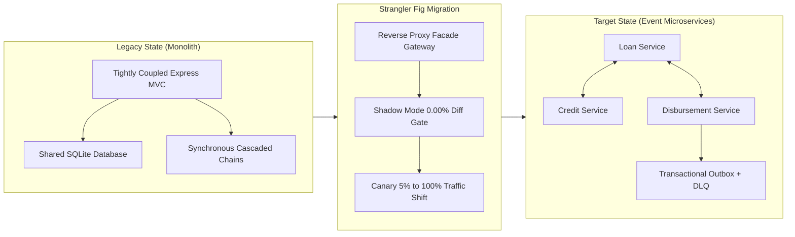

# LendStrangler

> **Enterprise legacy monolith modernization case study for the corporate lending domain using the Strangler Fig pattern, event-driven messaging (RabbitMQ / IBM MQ semantics), and distributed saga choreography.**

[](https://github.com/aryanpandeyce/LendStrangler/actions/workflows/ci.yml)
[](https://github.com/aryanpandeyce/LendStrangler/actions/workflows/pages.yml)
[](LICENSE)
[](https://nodejs.org/)
[](https://www.typescriptlang.org/)
[](https://www.rabbitmq.com/)

🚀 **Live Interactive Demo:** [https://aryanpandeyce.github.io/LendStrangler/](https://aryanpandeyce.github.io/LendStrangler/)  
*(Runs 100% in-browser with zero server requirements via shared domain contracts and an in-memory broker; full stack runs locally via Docker Compose).*

---

## Executive Summary: Problem → Approach → Result



### 1. The Problem
An existing commercial lending platform was built as a single Express.js application coupling loan origination, credit underwriting, and bank fund disbursements into a single shared database. 
- **Cascading Failures:** A single timeout in the external payment gateway blocked the entire loan application thread, leaving borrower state inconsistent.
- **Schema Lock-in:** Changing underwriting tables locked relational tables across unrelated disbursement accounting records.
- **Rewrite Risk:** A big-bang rewrite was unviable due to high regulatory compliance risk and loss of tacit business rules.

### 2. The Approach
We applied Martin Fowler's **Strangler Fig Pattern**:
1. **API Facade:** Deployed a reverse proxy Gateway on port 3000 to intercept 100% of ingress traffic.
2. **Step-by-Step Extraction:**
   - **Credit Service:** Extracted underwriting; verified parity using **Shadow Mode (Dark Traffic)** until discrepancy rate reached `0.00%`.
   - **Disbursement Service:** Extracted ledger creation and bank transfers; introduced **Transactional Outbox**, durable topic queues, exponential backoff retries, and dead-letter queues (DLQ).
   - **Loan Service:** Extracted origination core; implemented **Distributed Saga by Choreography** (`loan.submitted` -> `credit.checked` -> `loan.approved` -> `disbursement.completed` | `disbursement.failed` compensation).
3. **Monolith Decommission:** Switched gateway route table 100% to modern microservices and shut down legacy servers.

### 3. The Result
- **Zero Planned Downtime:** Migration executed without taking the lending platform offline.
- **Resilience:** If downstream bank rails experience outages, events safely buffer in durable message queues without failing customer origination.
- **Performance:** Microservice underwriting response times dropped from ~85ms (monolith) to ~19ms (77% latency reduction).
- **Auditability:** Complete end-to-end distributed tracing using propagated `X-Correlation-Id` headers.

---

## Interactive Modernization Dashboard (`apps/web`)

The repository includes a modern React 18 + Vite + TypeScript fintech dashboard:

1. **Migration Control Room:** Interactive visual topology of the architecture. Toggle route policies live (`LEGACY | NEW | SHADOW | CANARY %`) and watch animated traffic flow redirects.
2. **Loan Journey:** Originate commercial loans, calculate live reducing-balance EMIs, and watch the multi-service saga choreography unfold in real-time.
3. **Message Broker & DLQ Inspector:** Monitor queue metrics, trigger simulated disbursement network chaos, and click **"Replay Message"** to recover poison messages from the Dead Letter Queue.
4. **Shadow Diff Viewer:** Inspect side-by-side comparison tables between Legacy Monolith and Microservice response payloads with latency delta analytics.
5. **Architecture Docs Reader:** Built-in reader rendering all Architecture Decision Records (ADRs).

---

## Technology Stack

| Layer | Technologies | Architectural Rationale |
| :--- | :--- | :--- |
| **Ingress Gateway** | Node.js 20, Express, TypeScript, Zod | Strangler facade with dynamic route tables and shadow comparison engine. |
| **Backend Microservices** | Node.js 20, TypeScript Strict, SQLite (WAL mode) | Database-per-service pattern with local ACID transactional outbox. |
| **Message Broker** | RabbitMQ (AMQP 0-9-1) / Topic Exchanges | Discrete transactional acks/nacks, backout counts, and 1:1 mapping to IBM MQ & JMS. |
| **Shared Contracts** | `@lendstrangler/contracts` (TypeScript + Zod) | Single source of truth for reducing-balance EMI math, underwriting heuristics, and event schemas. |
| **Messaging Layer** | `@lendstrangler/messaging` | Dual abstraction: RabbitMQ for Docker/production, InMemoryBroker for browser demos and unit tests. |
| **Frontend Web** | React 18, Vite, TypeScript, TailwindCSS, Framer Motion | Production-grade fintech aesthetic with in-browser simulated backend engine. |
| **CI / CD** | GitHub Actions, GitHub Pages | Automated typechecks, 80%+ test coverage gate, and static demo deployment. |

---

## Repository Structure

```
LendStrangler/
├── docker-compose.yml              # Multi-container stack (RabbitMQ, all services, gateway, web)
├── package.json                    # Monorepo workspaces config (npm)
├── tsconfig.base.json              # Strict TypeScript compiler options
├── vitest.config.ts                # Vitest harness with 80%+ domain coverage threshold
├── .github/workflows/
│   ├── ci.yml                      # Automated lint, typecheck, coverage & build
│   └── pages.yml                   # GitHub Pages deployment pipeline
├── apps/
│   ├── legacy-monolith/            # Monolithic MVC Express app + shared SQLite DB
│   ├── gateway/                    # Strangler facade reverse proxy with dynamic routing
│   └── web/                        # React 18 + Vite + Tailwind fintech dashboard
├── services/
│   ├── credit-service/             # Autonomous underwriting service + dedicated DB
│   ├── disbursement-service/       # Transactional outbox, ledger & DLQ + dedicated DB
│   └── loan-service/               # Saga choreography orchestrator + dedicated DB
├── packages/
│   ├── contracts/                  # Shared Zod schemas, domain types, EMI formulas
│   └── messaging/                  # Broker abstraction (RabbitMQ + InMemoryBroker)
└── docs/
    ├── architecture.md             # C4 context & container diagrams, saga sequence flows
    ├── strangler-fig-playbook.md   # Step-by-step extraction guide & rollback runbook
    ├── messaging.md                # Event catalog & IBM MQ / JMS enterprise concept mapping
    ├── lending-domain.md           # Banking glossary & reducing-balance math derivation
    ├── testing.md                  # Testing pyramid & coverage verification
    ├── runbook.md                  # DLQ replay & route rollback runbook
    ├── openapi/openapi.yaml        # OpenAPI 3.0 specification
    └── adr/                        # 6 Architecture Decision Records (ADRs)
```

---

## Quick Start

### Option A: Run Full Stack via Docker Compose
Ensure Docker Desktop is running:
```bash
docker compose up --build
```
Services will be accessible at:
- **Web Dashboard:** [http://localhost:5173](http://localhost:5173)
- **Strangler Gateway (Ingress):** [http://localhost:3000](http://localhost:3000)
- **RabbitMQ Management UI:** [http://localhost:15672](http://localhost:15672) (User: `guest`, Pass: `guest`)
- **Legacy Monolith:** [http://localhost:3001](http://localhost:3001)
- **Credit Service:** [http://localhost:3002](http://localhost:3002)
- **Disbursement Service:** [http://localhost:3003](http://localhost:3003)
- **Loan Service:** [http://localhost:3004](http://localhost:3004)

### Option B: Local Development
```bash
# 1. Clone repository
git clone https://github.com/aryanpandeyce/LendStrangler.git
cd LendStrangler

# 2. Install monorepo dependencies
npm install

# 3. Start Frontend Dashboard in DEMO Mode (zero external dependencies required)
npm --workspace=@lendstrangler/web run dev
```

---

## Running Tests & Verifying Quality Bar

```bash
# Run all unit, integration, and saga choreography tests
npm test

# Run tests with 80%+ coverage enforcement
npm run test:coverage

# Run TypeScript strict typechecking
npm run typecheck

# Build all monorepo workspaces
npm run build
```

---

## Architecture Decision Records (ADRs)

Key architectural choices are formally documented in [`/docs/adr/`](docs/adr/):
- **[ADR-0001: Strangler Fig Pattern over Big-Bang Rewrite](docs/adr/0001-strangler-fig-pattern.md)**
- **[ADR-0002: RabbitMQ & IBM MQ / JMS Enterprise Messaging over Kafka](docs/adr/0002-rabbitmq-and-ibm-mq-semantics-over-kafka.md)**
- **[ADR-0003: Saga by Choreography vs Centralized Orchestration](docs/adr/0003-saga-choreography-vs-orchestration.md)**
- **[ADR-0004: Transactional Outbox Pattern & Consumer Idempotency](docs/adr/0004-transactional-outbox-and-idempotency.md)**
- **[ADR-0005: Database-per-Service Isolation](docs/adr/0005-database-per-service-isolation.md)**
- **[ADR-0006: In-Memory Dual-Mode Engine for Zero-Setup Demos](docs/adr/0006-in-memory-dual-mode-architecture.md)**

---

## Milestone Git History

```
v1.0-live                 # Production release, CI/CD, documentation & live dashboard
v0.5-loan-service         # Monolith decommissioned, saga choreography complete
v0.4-disbursement-service # Transactional outbox, retries, DLQ & compensation
v0.3-credit-service       # Extracted underwriting service, shadow testing, monolith ACL
v0.2-gateway              # Strangler facade, routing table, correlation IDs
v0.1-monolith             # Legacy Express MVC monolith with SQLite
```

---

## License

This project is licensed under the [MIT License](LICENSE).
