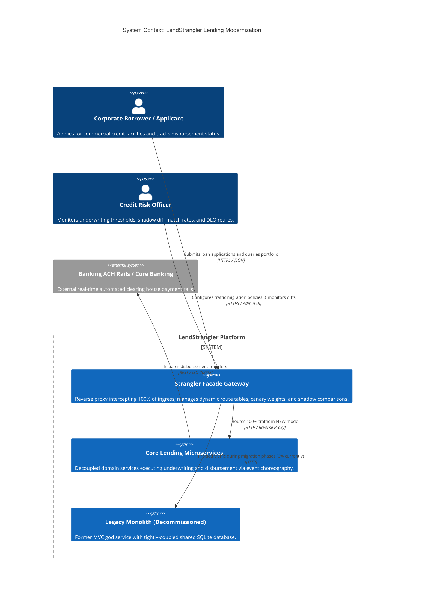
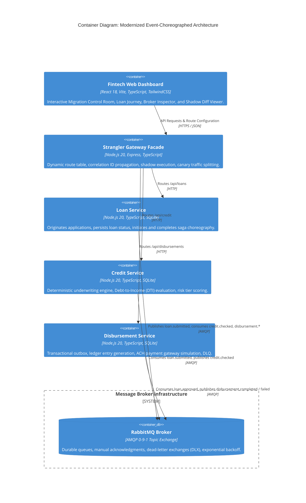
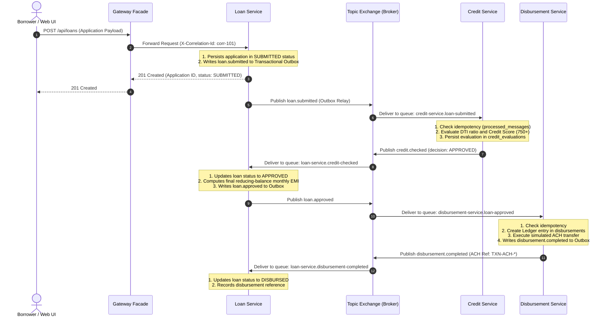
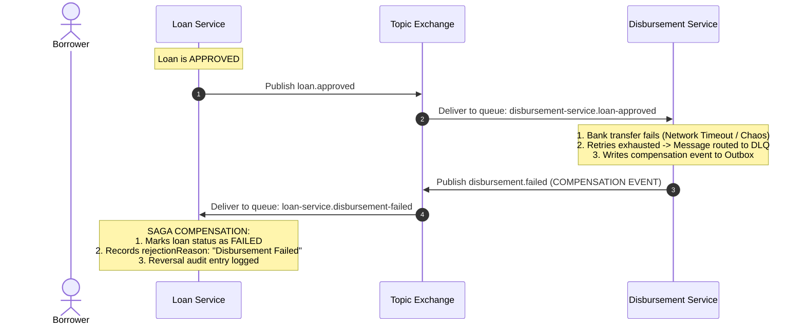

# Architecture: LendStrangler Modernization

This document provides a technical walkthrough of the **LendStrangler** target architecture, covering C4 diagrams, container topologies, and distributed saga event choreography.

---

## 1. C4 System Context Diagram

The LendStrangler system facilitates automated commercial and personal loan underwriting and bank disbursement transfers, migrating from a legacy monolith into event-driven microservices.

---

## 2. C4 Container Diagram

---

## 3. Sequence Diagram: Happy Path Loan Origination Saga

The saga uses **choreography**: services react to domain events published to the topic exchange without a central coordinator bottleneck.

---

## 4. Sequence Diagram: Failure & Compensation Saga Path

When an external payment rails failure occurs (or chaos is injected), the system executes compensating transactions to return the distributed system to a consistent terminal state.

